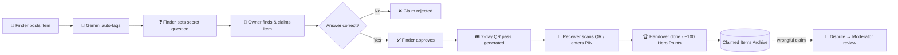

<div align="center">

# 🔍 CampusTrace

### Lost something on campus? Let's trace it back.

An AI-powered, zero-cost PWA that reunites students with their lost belongings — safely, and without fraud.

[](https://campustrace.pages.dev)


</div>


## 💡 Why CampusTrace?

Campus lost & found usually means WhatsApp groups, notice boards, and a lot of "is this yours?" guessing. That brings three problems:

| Problem | CampusTrace's answer |
| --- | --- |
| Posting items is slow and listings are messy | **Gemini AI** auto-tags category, colours and keywords from a photo |
| Anyone can claim anything | **Secret question** set by the finder must be answered correctly |
| Sharing phone numbers is unsafe, especially for girls | **Privacy Shield** — in-app chat, numbers stay hidden |

---

## ✨ Features

### 🧠 Smart Posting
- **AI Auto-Tagging** — upload a photo and Google Gemini detects the category, colours and search tags for you.

### 🔐 Anti-Fraud Handover
- **Secret Question Verification** — the finder sets a question; the claimant must answer it before the handover is approved.
- **2-Day Single-Use QR Pass** — generated on approval. The receiver scans it (or uses a 6-digit PIN) to finalize the handover.
- **Hero Points** — finders earn **+100 Hero Points** for every completed handover. 🎉

### 🛡️ Safety & Trust
- **Girl Student Privacy Shield** — phone numbers are never exposed; coordination happens through secure in-app chat.
- **One-Click Disputes** — wrongly claimed item? Dispute it in one tap.
- **Moderator Review** — Campus Safety Moderators inspect the full 360° audit file and investigate via direct chat.

### 🏫 Administration
- **Campus Admin Center** — admins create and revoke credentials for moderators and security staff.
- **Claimed Items Archive** — a permanent record of every resolved item.

### 💸 Zero-Cost Architecture
- Runs fully on Firebase's free tier. Images are **compressed client-side** and stored in Cloud Firestore, so no paid storage bucket is needed.

---

## 🔄 How It Works



---

## 🛠️ Tech Stack

| Layer | Technology |
| --- | --- |
| **Frontend** | React 19, Vite, Lucide Icons, Canvas Confetti |
| **QR & Scanning** | QRCode, HTML5-QRCode |
| **AI** | Google Gemini API (`@google/genai` / REST) |
| **Database** | Firebase Cloud Firestore (Spark Free Tier) |
| **Hosting** | Cloudflare Pages |
| **App Type** | Progressive Web App (installable) |

---

## 🚀 Getting Started

### Prerequisites

- [Node.js](https://nodejs.org/) 18+
- A [Google Gemini API key](https://aistudio.google.com/app/apikey)
- A [Firebase](https://console.firebase.google.com/) project with Cloud Firestore enabled

### Installation

```bash
# 1. Clone the repo
git clone https://github.com/kishan-ict/CampusTrace.git
cd CampusTrace

# 2. Install dependencies
npm install

# 3. Set up environment variables
cp .env.example .env
```

Open `.env` and fill in your **Gemini API key** and **Firebase config** values (the variable names are listed in `.env.example`).

```bash
# 4. Run the dev server
npm run dev
```

Then open **http://localhost:3000** 🎉

> ⚠️ Never commit your `.env` file. It's already in `.gitignore`.

---

## 👥 Roles

| Role | What they can do |
| --- | --- |
| **Student** | Post found items, claim items, chat in-app, earn Hero Points, raise disputes |
| **Moderator / Security** | Review disputes, inspect audit files, investigate via chat |
| **Campus Admin** | Create and revoke moderator & security credentials |

---

## 👨‍💻 Author

**Kishan** — Full-stack developer & founding member of [ALEROPATH](https://aleropath.pages.dev)

[](https://github.com/kishan-ict)

---

<div align="center">

If CampusTrace helped you, drop a ⭐ — it really helps!

</div>
